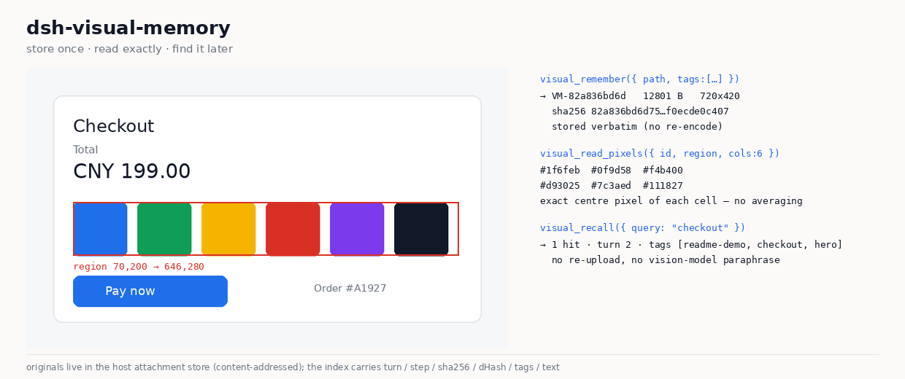

# dsh-visual-memory

给 DSH agent 的**无损视觉记忆**：图存一次，之后每个问题都从原始字节回答——像素精确、帧可重放、
可按文字/标签/sha256/轮次/近似重复找回，不经过第二个视觉模型的转述。



`DSH 0.2.0-rc.2` · `Node >= 22` · MIT · `node verify.mjs` 17/17

English | 中文

## 安装

```sh
# 推荐：直接锁仓库，任何 registry 镜像下都成立
dsh plugin --profile <name> add github:xiciyang/dsh-visual-memory

# npm（registry.npmjs.org）短命令
dsh plugin --profile <name> add @xiciyang/dsh-visual-memory
dsh --profile <name> --dump-config      # 应出现 "# == @xiciyang/dsh-visual-memory" 这一层
```

> **装的时候报 `0.0.0-stage`？** 那是 pnpm 的元数据缓存过期（首次 staged 发布留下的占位版本被缓存了），
> 不是包坏了：`pnpm store prune`，或删掉 `~/.cache/pnpm/*/metadata/<registry>/dsh-visual-memory.jsonl` 再装即可。
> 当前版本用 `npm view @xiciyang/dsh-visual-memory version` 查。

一个 bundle 层、七个工具。卸载：`dsh plugin --profile <name> remove @xiciyang/dsh-visual-memory`。

从本地源码装：

```sh
git clone https://github.com/xiciyang/dsh-visual-memory
dsh plugin --profile <name> add ./dsh-visual-memory
```

## 30 秒判断它是否适合你

| 你要做的事 | 用这个 | 而不是 |
|---|---|---|
| 读某个历史截图里某一格的精确颜色 | `visual_read_pixels` | 让视觉模型"再看一眼"然后信它编的 hex |
| 对比两个 UI 状态 / 重放某一帧 | `visual_inspect`、`visual_compare` | 每轮都重新上传两张图 |
| 找回第 40 轮见过的那张图 | `visual_recall`（文字/标签/sha256/轮次/dHash） | 往回翻对话 |
| 原样保存一张截图（不改一个字节） | `visual_remember`（逐字节、内容寻址） | base64 塞进文本记忆 |

**不适合**：你要的是云端图床（这里是本地文件）、Android（像素引擎会起 `python3`）、
或者只是一次性"描述这张图"——DSH 原生图片输入已经覆盖。

## 为什么不是"又一个记忆插件"

文本记忆存的是**描述**，这里存的是**原始字节**：原文件逐字节落盘、按 sha256 内容寻址，之后所有问题都从原图回答，
而不是从视觉模型的转述回答。两个直接后果：

- **像素是准的**。`visual_read_pixels` 返回每个格子的 `#rrggbb`，不会像视觉模型那样四舍五入；
- **换模型不改答案**。同一条记忆在任何路由下都可复现，因为证据是文件本身。

## 安装

```sh
# 从公开仓库装（npm 发布待完成）
dsh plugin --profile <name> add github:xiciyang/dsh-visual-memory
dsh --profile <name> --dump-config   # 应出现 "# == @xiciyang/dsh-visual-memory" 这一层
```

从本地源码装：

```sh
git clone https://github.com/xiciyang/dsh-visual-memory
dsh plugin --profile <name> add ./dsh-visual-memory
```

## 快速开始

```js
// 1. 把当前看到的图存下来，并让它可检索
visual_remember({ path: "./shot.png", text: "结算页，¥199，两个按钮", tags: ["ui","checkout"] })

// 2. 之后不用重新上传，直接找回来
visual_recall({ query: "结算" })        // 也支持 sha256 / id / tags / 轮次区间 / 近似重复

// 3. 精确读某几个格子的颜色
visual_read_pixels({ id: "VM-…", region: "120,40,200,80", rows: 2, cols: 4 })

// 4. 把过去多帧裁到指定区域、放大、拼成一张带标签的对比图
visual_inspect({ views: [{ id: "VM-…", region: "0,0,800,600" }, { id: "VM-…" }], layout: "side-by-side" })
```

## 运行要求

- **DSH 0.2.0-rc.2**（`engines.dsh: ">=0.2.0 <0.3.0"`）；包内声明 `dsh.bundle.patch`，`dsh plugin add` 才会激活这一层。
- **Node.js ≥ 22**。
- **Python 3 + Pillow**（`python3 -m pip install pillow`）：像素引擎 `lib/imaging.py` 是子进程，插件不自带图像编解码。
- **仅限桌面 / 服务器**：像素引擎 spawn `python3`，Android 暂不支持（`dsh-plugin-lint` 报 `A2-subprocess-tool`）。纯 JS 后备是下一步。
- **观测路径**需要声明了 image 输入的模型路由；插件不假设，而是探测实时路由（`visual_memory_status.routeCapability`）。
  纯文本路由下图片照样存储，可通过 DSH 输出的 `sha256:xxxxxxxx` 句柄找回。

## 配置

没有配置文件——三个位置由宿主约定决定，改工作区即可改存储根：

| 内容 | 位置 | 说明 |
|---|---|---|
| 记忆库 | `<会话工作区>/.dsh-visual-memory/` | 每个工作区一套，`index.jsonl` 追加式 |
| 库注册表 | `$DSH_HOME/visual-memory-roots.json` | gallery 路由用；最近 20 个工作区 |
| 原图 | `$DSH_HOME/attachments/v1/files/<sha>/` | 逐字节、内容寻址，不随索引删除 |

要换存储位置，换会话工作区；要清空记忆，删 `.dsh-visual-memory/`（原图仍在 attachments，可回收）。

## 兼容性

| DSH | 状态 |
|---|---|
| 0.2.0-rc.2 | 2026-10-17 验证通过：`node verify.mjs` 17/17，真实工具端到端调用 |
| < 0.2.0 | 未测试；`engines.dsh` 会拒绝安装 |
| ≥ 0.3.0 | 未测试；要放宽版本范围，先在该版本上跑一遍 `npm test` |

## 验证

```sh
npm test          # = node verify.mjs
node verify.mjs   # 17 项检查，不需要启动 DSH 进程
```

覆盖：加载器强制的 bundle 契约、重启后仍生效的 profile 接线、用已知颜色夹具验证像素引擎（probe / read_pixels / crop /
compose / overlay）、曾经把工具打挂的 lossless-JSON 不变量、以及把每张已存原图重新哈希对齐 sha256。

它**不**声称覆盖宿主侧路径（`ctx.attachments`、`ctx.fs`、`ctx.tools`）——那部分靠真实调用工具验证。

## 能力对照（对标 VISTA）

| VISTA harness 组件 | 本插件 |
|---|---|
| 视觉观测（模型收到像素） | DSH 原生多模态输入 `read_image`；路由声明的模态是探测出来的，不是假设的 |
| 无损视觉记忆（原始形态，按 turn/frame 索引） | `visual_remember` → `ctx.attachments.saveFile` 逐字节存储（内容寻址、不重编码）+ 追加式索引（turn/step/seq/sha256/dHash/尺寸/tags/text） |
| 主动检索过去的观测 | `visual_recall`：query / id / sha256 前缀 / tags / 轮次区间 / 时间序 / 感知近似 |
| 空间上的视觉检查（原图任意区域放大） | `visual_inspect` 的 `region` + `scale`；临时裁剪交给 `vision_crop` |
| 跨时间的视觉检查（多帧一次取） | `visual_inspect` 把 N 张存档观测拼成一张带标签的图 |
| 状态对比 / 回放 | `visual_compare`（并排 / 网格 / 堆叠） |
| 精确像素（VISTA 的 `read_pixels`） | `visual_read_pixels`：rows×cols 的 `#rrggbb` 中心读数矩阵 |
| —（混合路由，论文没有） | `visual_memory_status.routeCapability` 解析实时路由并报告 `nativeImageInput` |

## 工具

| 工具 | 回答什么 |
|---|---|
| `visual_remember` | 把这张图无损存下来，并让它可被找到 |
| `visual_recall` | 那张图是哪张 / 按文字、哈希、标签、轮次、相似度找回来 |
| `visual_attend` | 把我**看过**的区域画在图上，并记账 |
| `visual_inspect` | 把这些观测、这些区域，放大，拼成一张 |
| `visual_read_pixels` | 每个格子的颜色到底是多少 |
| `visual_compare` | 把这些图并排放在一起并标注 |
| `visual_memory_status` | 现在到底有什么能力，当前模型能不能看见 |

Web 接缝：`GET /_dsh/visual-memory/gallery` 渲染记忆库（缩略图、注意力账本、索引文本、哈希）；
`/_dsh/visual-memory/raw?id=VM-…` 返回逐字节原图，`&v=<变体>` 返回该条目自己登记的叠加图或对比图。

Web 接缝不是 Agent 的权限边界：每个请求先经组合的 `connection.requestRejection`
（Host/Origin 栅栏 + 浏览器认证）放行；`root` 只能是本插件登记过的库；`v`
只能取自该条目登记的变体，且真实路径必须落在该库的 `artifacts/` 内——调用方给的路径永远不会被读。

## 存储布局

```
<会话工作区>/.dsh-visual-memory/
  index.jsonl                 追加式；按 id 折叠，后写覆盖
  artifacts/attention/*.png   注意力叠加图
  artifacts/compare/*.png     对比图
  artifacts/inspect/*.png     单视图裁剪 + 拼接图
~/.dsh/visual-memory-roots.json   哪些工作区有库（gallery 路由用）
<DSH_HOME>/attachments/v1/files/<sha>/<name>   逐字节原图
```

## 能力边界

- **字节** 归 `ctx.attachments`（宿主服务，逐字节 `saveFile`，内容寻址）
- **裁剪 / 像素差 / 调色板 / 描摹 / OCR / 看图问答** 归 `dsh-vision-toolkit`
- **索引 / 注意力账本 / 带标签合成 / 多视图拼装 / 能力探测** 归本插件

`visual_attend` 只产出**叠加图 + 注意力账本**（把"看过哪里"变得可见且持久），裁剪本身仍交给 `vision_crop`——
每个能力只有一个实现，避免第二套实现分叉。

## 许可

MIT，见 [LICENSE](./LICENSE)。
